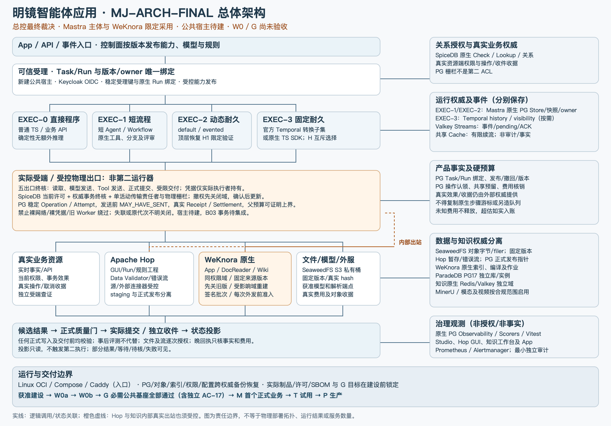

# 最终架构的职责、接口与实施约束

[当前架构入口](../current-architecture-baseline.md)及 ADR 0002 记录总控决定。本页把 F03 v1.1 的详细设计与 F04、H、H1、H2 接到同一套实施契约。下文的操作及状态名描述明镜要提供的语义。真实 HTTP 路由、服务身份、发布制品和资源方配置在建设时登记。

[可编辑 SVG](architecture.svg) · [40 项选型与依赖](technology.csv) · [37 项复用与必要开发](reuse.csv) · [24 项许可与收费边界](licenses.csv) · [76 项需求与关口](../../requirements/final-architecture-mapping.csv)

## 控制面、执行面、数据与能力面、治理与观测面

| 逻辑面 | 承担的责任 |
| --- | --- |
| 控制面 | Agent、Workflow、Tool、Hop 工程、知识配置、授权 schema、模型与质量规则在 Git 版本化。工作台保存草稿；受控发布操作将 PG 的正式启用、停用或撤回指针绑定到相应构建和规则。发布后仍需当前主体与用途获得授权才能执行。 |
| 执行面 | 用户、API 和业务事件经可信受理进入 Mastra Server。按任务调用直接程序、固定 Workflow、短 Agent 或持久动态 Agent；一个 Run 只有一个执行所有者。 |
| 数据与能力面 | 真实业务 API 提供权威事实；Hop 处理和质检数据，SeaweedFS 存固定版本字节，WeKnora 管知识派生与索引。发布、受控模型或外服接入各由对应权威负责。 |
| 治理与观测面 | 身份、关系授权、各出口的最终核验、操作与预算、质量、审计、评测和运行监控贯穿前三面。管理查询、导出和调试也要重核读取权限。 |

以上职责可以共进程部署。任务、原生运行、业务效果和收件记录通过稳定编号关联。

| 事实 | 权威持有者与可查凭证 |
| --- | --- |
| 用户意图、任务受理、当前可见结果 | 应用 PG 保存组织、发起人、受理键、请求摘要、Task、原生 Run 的绑定及合格发布版本。相同键、相同载荷查原件；同键换内容拒绝。合法欠参只建待补 Task；补充时重核身份和前提，完整后产生唯一派发意图。 |
| 程序、短流程、持久动态流程 | 确定性程序直接调用，Mastra Server/SDK 复用 Agent、Tool、Workflow。EXEC-2 的过程、步骤身份、检查点、响应回放和运行代次由 Mastra Store 负责。若 EXEC-3 的严格固定流程需要 Temporal，选官方转换器支持的静态子集或原生 TS SDK 之一，仅此 Run 以其 history 为权威。 |
| 身份、资源与正式效果 | Keycloak 的 OIDC 身份绑定组织和主体；SpiceDB 管关系与一致性版本，真实资源方在最终读取或写事务内核动作、版本与用途。受端按操作号持久化幂等结果；受控交付另按交付号和收件人查收、重开。 |
| 上下文、事实、费用 | Mastra Memory 保存会话；选用的上下文逐段重核合法来源。业务事实取实际 API/固定原件，独立收件系统记录交付，供方回执核实际费用。Trace、进度事件、缓存和模型叙述只提供诊断信息。 |

## 运行与扩展

- 一个能力版本发布输入输出 Schema、动作/用途、错误、超时、幂等、查单、取消、成本上界、权限和质量契约。注册、发布、获准发现、实际执行分别核验。工具、异步流程、外部服务和普通程序可复用同一能力。模型提出的计划、参数和身份均须在可信执行边界验证。
- EXEC-2 优先使用固定发行的原生 Run、步骤与响应恢复。先绑定可查询 ID，丢受理回执按原号查证；按原生发生位置区分相同输入的两个合法回合，保存完整响应、关联真实传输，恢复时重用。已发送却未保存、无权威可查时停止新增，向用户展示待核。嵌套委派、并行分支、工具已执行但响应未记，分别以实际效果验证。接管时旧执行进程的模型和工具出站资格须同步失效。[H1 固定运行实现](https://github.com/mastra-ai/mastra/blob/10484e3b5544f0a160bc28446e4584be1a32c8e5/packages/core/src/agent/durable/durable-agent.ts)
- 事件化按需采用 Valkey Streams 与独立共享续流缓存。PG 快照、broker pending/ACK、客户端流游标各自保留职责，截断不能丢失未确认的恢复依据。测试旧租约、重投、等待释放资源、客户端断线重连、两种版本的排空与恢复。未启用 EXEC-3 时用关闭证据说明；确需严格定时、信号、取消及长等待时再验固定路径。
- 保留串行、并行、条件、分解汇总和生成→独立评审→通过或有界修订。失败依赖阻断，汇总可显示部分完成。正式写入或交付前设置确定性质量门。错误结果即使工具返回成功也拒交；以合格对照与真实收件记录验收。事后评测采用 Mastra Scorers/Evals、版本化金样和 Vitest。
- 上下文筛选、裁剪和摘要保留获准版本、出处及有效期，模型回复不能覆盖真实业务事实。长期记忆按适用场景启用，启用前验证确认、冲突处理、更新、撤回和删除。特殊执行器、外部协议按获准能力接入，网络、凭据、租户和费用隔离须先验。未启用时验证入口确实关闭。

## 新公共宿主的建设责任

明镜应用后端尚未建设。由公共基座承建能运行任务的最小真实宿主，W0 可使用业务中立的对象、隔离身份和独立测试收件端。进入具体业务后，实际资源权限、业务效果和本人收件须在对应资源方再次验证。

| 先后依赖 | 公共基座承担的建设与验收 |
| --- | --- |
| 1 身份与授权 | 复用 Keycloak 的账号、组、服务身份和会话；Mastra Server 校验 issuer、audience、签名和有效期。SpiceDB 写删关系、查权并保留变更版本。停用、成员到期、撤回、管理员直改均有变更源；权威失联时受保护出口关闭。 |
| 2 受理与查询，依赖 1 | 复用 Mastra Server 暴露受保护的受理、查终局、补充和取消操作。PG 受理键、版本、运行所有者、启动意图与必要预留同事务。按原号可区分待补、已提交、等待、部分完成、取消请求与结果待核。 |
| 3 五个出口，依赖 1、2 | 读取资料、发送模型、调用工具、业务提交、受限交付各自有唯一受控发送方、最小凭据与资源端终核。撤权先关闭受影响域，明确当前授权变化与不可撤回交接的因果顺序；流/文件后续字节重核。旧 Worker 隔离或由真实出口核代次，避免旧进程恢复后继续外发。在途已生效结果按原号查证。 |
| 4 操作与共享预算，依赖 2、3 | 一个逻辑 Operation 核内容和资源，每个实际物理发送另有 Attempt；PG 一次事务认领并预留可证明的费用上界。外发前持久登记可能已发送；未知保留预留，超时查真实受端。只有查明未受理且幂等窗口有效才重试；核真实收据一次、超估如实入账并关闭新增。并发子任务、供应商内部重试、模型、工具和解析共用父额度。 |
| 5 交付与管理，依赖 1–4 | 质量、版本和权限在正式提交前重核。本人按独立交付号查收、重开时再核权。业务写入成功而交付失败要分别显示；晚到结果仅限核对。管理员按角色有发布/撤回、费用待核、独立审计、退役及回退操作。优先用原生后台，确实缺少的业务管理页面用 React-admin OSS 调受控 API。 |

## 数据、原件与知识

**Apache Hop 与 SeaweedFS。** 数据工程由 Hop GUI 编辑规则、Hop Run 运行。真实来源经隔离连接器进入暂存区，Pipeline Unit Test 只检验给定样本。真实运行由 Data Validator 和 SQL 约束逐行核验，错误行进入隔离流；处理成功、质量合格、正式发布和撤回分别记账。PG 只发布通过校验的版本；撤回关指针。知识连接器直取经授权的正式版本，避免重复做 ETL。SeaweedFS 私有桶和 S3 接口保有固定对象字节、版本和摘要；AWS SDK v3 与 WeKnora 原生 S3 接线分别验证覆盖写、读回、删除、失败孤儿和恢复。仅约定“不复用键”无法防止同键被覆盖。验证所锁制品的条件创建，或保存实际 versionId 与完整字节 SHA-256；隔离正式源与 WeKnora 的可写桶和凭据。G 主动覆盖同键后按原引用读回，字节与原摘要须一致。multipart ETag 不作 SHA-256。下载只经受控入口；filer 元数据、对象卷和发布清单须可一致恢复。

**WeKnora v0.9.1 是唯一知识主体。** 同权限知识域以不可变发布版本承载，编译批次冻结全部来源 ID、版本、用途、模型配置和父预算。一个固定规模的后台、队列和 DocReader 可以复用；每个在建版本独占逻辑批次。同一员工可访问多个已获准域，不按员工或任务开实例。知识搜索依赖的 ParadeDB/扩展、原生 Redis 协议及与 Valkey 的兼容单独核验。数据库、桶、角色及员工/运营入口各有边界。

1. 受控上传入口签发绑定域、版本与文件摘要的批次凭据。v0.9.1 持久化文档解析配置 `process_config.parser_engine_overrides`，随作业传给 DocReader。解析出口验签、校验当前授权与实际字节，去除内部凭据后才调用解析端。模型配置和服务凭据固定到版本，失效凭据不能给下一批重用。文件摘要、静态头和时间顺序均不能单独决定归属。扩展字段的持久化与重试传递须做升级回归。[固定上传接口](https://github.com/Tencent/WeKnora/blob/71c32af9273482e0dad013d0e3bea2f4d719516c/internal/handler/knowledge.go#L398-L409) · [解析传递](https://github.com/Tencent/WeKnora/blob/71c32af9273482e0dad013d0e3bea2f4d719516c/internal/infrastructure/docparser/grpc_parser.go#L141-L163)
2. 聊天、向量、解析及适用重排、图像、音频、视频出口在每次物理发送前准入，含重试。在线问答使用独立请求预算。H2 以获准编译批次为结算单位；若需按原生子作业单独授权或计价，须取得可信绑定。读、问答与多来源 Wiki 均要验证**全部**来源在当前用途获准；混权内容不可借助手工编辑、历史或缓存绕行。
3. 撤回先在事务中关闭所有受影响的旧发布并登记重建；旧页、引用、下载、历史及预热缓存打开时重核，不释放受限字节。按原件到发布域的反向依赖定位受影响域，从空白版本只读当前合法原件，排除旧正文、无登记的手工段落及跨域摘要。域内更细闭包无证据时整域重建。核清单、内容和引用后切换指针；失败保持关闭，无关域继续提供服务。
4. A07 保留复杂文档、页码/表格/坐标、图片区域、音视频时间定位、中文召回、重排、引用回答与跨来源 Wiki。MinerU、各模态模型及服务按相应制品、协议与商用许可验收。记录每次撤回涉及域数、编译原件数、不可用时长、双版本空间、各出口实费与质量。超过业务批准边界或必须长期重写知识核心时仅提交 A07 局部反转；本次没有启用备选。

## 六个公共工程工作包

下列 C1–C6 是建设责任；复用表里的 C01–C37 是单项机制。业务部门在 M 接入具体规则、资源或体验。G 要求提供确实建成的公共部分和实际维护改动。

| 工作包 | 基座要交付什么 | 复用与停止边界 |
| --- | --- | --- |
| C1 任务与能力 | 任务受理和唯一 Run 绑定、版本化发布、权限前筛、进度/部分结果投影、独立接入测试。 | Mastra 承担运行与扩展；不另写循环或检查点。 |
| C2 身份与真实出站 | 组织主体和资源关系、变更因果顺序、五类出口、旧 Worker 栅栏。 | 配置 Keycloak/SpiceDB，复用资源方事务；不另造权限计算平台。 |
| C3 操作与预算 | 逻辑操作、物理尝试、父预算预留、未知持留、独立查单、唯一核销及可查审计。 | PG 本地事务配真实受端幂等和收据；不仿造外部效果。 |
| C4 数据、知识与交付 | 正式数据质量、来源版本和反向依赖、受控发布/撤回、批次准入、受控下载、独立收件、孤儿处置。 | Hop、SeaweedFS、WeKnora 负责编排转换、字节和知识原生作业；不另建 RAG、ETL 或对象平台。 |
| C5 管理与评测 | 必要管理操作、查询投影、金样和受控评测，以及用户可理解的终局。 | 免费原生控制面优先，React-admin 只补缺页；审计与质量门独立。 |
| C6 部署与运行 | 锁定制品、两版本交接、按任务分类观测、跨权威备份恢复和真实演练。 | 复用现有 CI 与成熟部署、监控、备份工具；按目标环境实测。 |

## 模型、运行环境与恢复

通用任务复用 Mastra AI SDK provider；兼容层核工具、结构化输出、上下文、失败和最大输入/输出。F03 的 Qwen 文本、嵌入及重排配置仅供获准后验收，具体协议、地区、快照、商用、数据外发和费率须逐项签认；升级向量维度或模型必须新建索引再切版本。资源计量区分实费、预留、估算和分摊，覆盖计算、存储和外服。Mastra Observability/Studio 供受信工程域查询，正式授权、审计、费用与交付另有独立持久收据。Prometheus、Alertmanager 负责监控，产品行为埋点须另获准外发。

Linux OCI/Compose/Caddy 为部署方向。运行、产品、身份、权限、知识/索引和观测按实际角色分库；锁定镜像、包、依赖、许可证及受支持升级路径。混合负载覆盖短、长、等待、批处理与租户公平；在目标环境测吞吐、积压、成本和过载拒绝。两版本停接、排空、回退及数据迁移分别取证。pgBackRest、restic 和各组件支持的恢复方式在独立环境还原 PG、filer/对象、知识索引、最新关系、模型配置和外部收据；对账结束前关闭出站，避免复活已撤权限和重复操作。临时开发机不能定出生产容量、日期、RPO 或 RTO。

[实施关口与风险](gates-and-risks.md) · [实验结果和受控原件](../../tasks/architecture-baseline-transition.md)
