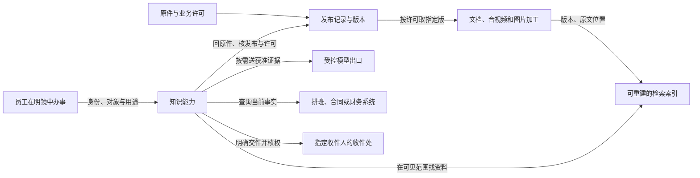

# 明镜全机构知识库架构方案

**提交评审。** 项目方已确认 PR #23 中的需求版本 `43b6f23`。本方案建议知识库沿用明镜既有任务、授权与交付边界，业务方决定什么资料能发布、能给谁作何用途。资料较少时也应能凭编号打开一份有出处的原件。检索、解析和模型可随资料类型分别选配。具体产品、部署形态与选用范围待调研回件后综合决定。[已确认需求原文](https://github.com/zhuquanwei111/mingjing---agent/blob/43b6f2384bd8d9afc54ec0f0bda26fb9117a1d25/docs/requirements/knowledge-base-requirements.md) · [五层技术选型方案](knowledge-base-selection.md)

## 谁掌握什么事实

| 参与方 | 负责的事实与动作 | 交给下一方什么 |
| --- | --- | --- |
| 明镜宿主与公共层 | 确认当前员工、机构、项目、动作和用途，承接任务、操作号、预算、交付与审计。直接查原件或查业务数可走确定性入口，需要长时间恢复的作业沿用既有调度。 | 给知识能力传可信的身份、范围和请求号。用户在对话里说“我是主管”不能改变权限。 |
| 原件、许可与发布负责人 | 原作者修原件，指定发布人管版本、有效期、撤回和受影响清单。客户授权、音乐及出镜许可由对应权利记录的负责人确认；各资料源在实际读取处落实当前许可。 | 一份资料有稳定资料号；每次修订有独立版本。发布记录指回原件、许可、适用日及发布人，明确查阅、转交、改剪、教学、对外投放等动作。每类原件只指定一个版本权威。 |
| 解析、检索与回答 | 文档及媒体加工产出可回看的证据位置。检索只在获准范围内找候选，回答引用能够核实的事实，按需澄清项目、日期或用途。 | 同时返回资料号、版本、页／行／时段、适用条件和缺口。索引、缩略图、向量和生成摘要都继承来源限制，均可从获准原件及发布记录重建。 |
| 业务系统与真实收件处 | 合同负责人保管已签条款，财务核到账，排班方核空档；资料交付以指定收件处可查的结果为据。 | 现时状态附对象、查询时点和出处；未送、已发待核、已送达、对方已确认分别记录。业务已经交付的历史事实按权限保留。 |

沿用路线 B 的 Capability 契约。普通读取直接调用；后台解析、换版或重建需要跨进程恢复时复用公共任务与调度；需理解口语、解释材料时才走受控模型出口。现有 P2 可复用的契约范例包括按资源授权、产物重开和按操作号查回执。知识版次、用途许可、跨资料引用以及真实宿主的联合核权仍须实现方用同一条链验证。下列分工可以在同一应用内完成，部署数量留待候选比较。[路线 B 终裁及接入契约](whole-product-decision.md#capability-onboarding) · [P2 现有能力与限制](../../core/README.md)

## 一份原件如何成为可用、可撤回的资料

1. **登记与发布。** 按来源机构、来源系统、对象及原版本标识登记，带上来源地址、版本指纹、负责人、状态、适用时间。草稿可交指定审核人。批准发布时记录所据许可的范围和有效期，才对相应读者可用。按“当时按哪版”查历史时，同时校验今天查阅历史的权限；一次客户例外只适用批准的对象与期限。
2. **提取证据并建立索引。** 处理任务固定原件版本和处理配置。表格片段带表头、单位、脚注和原行列，视频片段带剪辑版、时段及证据类型。每个衍生件登记“引用哪一版哪一段”；教案、题目、分享入口同样登记引用与负责人。换版可找出受影响引用。解析晚到、重复通知或重建时，先核当前发布状态再启用结果。
3. **查找、回源与回答。** 员工问“那个蓝尾巴能发吗”，先用有权看到的项目、附件和前文缩小范围，必要时追问收件人及用途。已知编号直接回源；需要发现资料时按词或按意思找。实际读原件、送解析或模型、向员工显示回答／预览、交付，以及从受控旧入口重开，都要在各自交接处按当前对象、版本、动作、目的地与用途复核。外部处理方另须有处理该资料的许可和预算。模型出口收可核实的最少片段，资料中的文字一律作为资料。缺画面、授权或当前流水时返回有据部分并点明缺什么。
4. **交付与收件。** 预览、问答不会触发转交或预约。正式业务写入由业务方按稳定的**业务操作号**去重并可查终局。每次定向交付另用一个稳定的**交付号**，绑定机构、指定收件人、资料版本和用途。商务、客户、带教各自在实际收件处按本人交付号查询与重开。收端按交付号去重。业务已成但交付回执丢失时保留业务终局，显示“已发出，送达待核”，只查原交付号，确认已收再补记。无法权威查单的正式出口限于受控预览。重开时再核当下权限。模型历史、任务日志和通知保存受控引用及必要审计字段；显示旧消息时动态核掉受限摘录。[固定宿主交付契约](https://github.com/zhuquanwei111/mingjing---agent/blob/8095d6f79e2e4e42fbdef03c8fdbfdf6b4785b35/docs/designs/w0-host-design.md)
5. **修订、撤回与恢复。** 修订保留旧交件事实。资料维护人按引用通知每份教案负责人，带教核新片许可、改讲义和题目，未处理的练习暂停。撤回以权威状态生效为界，所有新取用（含缓存命中、旧分享、模型送出）受同一决定约束；随后移除受影响的索引、缓存和预览，完成前继续拦读。登回原账号、重放任务、从备份恢复都需先核最新撤回与授权，再开放读取。已合法下载或此前合法发送的副本由负责交付的人通知停用并追回执。

### 用员工的交接检查架构

| 同一条晴禾片尾走到哪里 | 两端应能对上的结果 |
| --- | --- |
| 编导交给商务，商务交给客户或带教 | 发送方和本人收件处对上版本、对象、用途及各自的交付号。客户只收约定客户版。带教在自己的收件处收去标识、换音乐的教学版，核准班级和有效期后才进教案。 |
| 教学许可有效，新人想把片段存下来或转给别班 | 课内播放出口核班级、用途及片段范围。下载原文件由取件出口另核导出权，只有课内观看权的学员不能下载；将播放链接转给班外人，接收人以本人身份打开只见无权访问。验收需看实际播放和取件结果；人工翻拍或录屏属于后续传播处置。 |
| 原片换剪，学员说“讲义里那一秒还是远景” | 编导说明哪版哪一秒变了，维护人能列出旧引用，本课带教负责改。只改讲义秒数时复核旧片即可；更换视频时须核新版教学许可。学员从相同课程入口重开，看到正确画面或暂停提示。 |
| 只撤教学许可，再对照原片及两种用途均撤回 | 前者令学员从旧群链接、课件、收藏和旧回答只见停用提示及带教入口，班外人只见无权访问；晴禾仍按独立许可取用。后者连客户收件处也打不开受限画面。用同一链接恢复班级读权，撤回内容仍不可见。 |

处理并发时，授权权威与实际交接出口须能确定撤回和首次不可撤销交接谁先发生，例如由同一受控出口串行受理两者，并将交接与收端记录关联。若在检索时有权、送往模型前已撤回，模型收端应收到零受限内容；此前已经合法送出的保留事实及补救记录。只靠定时同步或不可撤销的直链无法保证次序时，关闭相应受限出口。权限源失联时，暂停依赖它的读取和交付。恢复备份后，须先与权威方核对恢复点之后的撤回和授权变更；无法确认最新状态的资料保持不可用。检索或模型不可用时，仍可按当前授权回原件，由员工检查原页、原片或业务记录。排班、款项等现时事实单独回源。

## 架构路线如何取舍

| 待比较的路线 | 适合明镜的前提及收益 | 要付的代价与改变选择的证据 |
| --- | --- | --- |
| 原件和发布留在现有业务平台，明镜按员工身份回源 | 资料已经有人在原平台持续修订、审核，且能稳定定位历史版本。可保留原有工作入口，减少重复维护。 | 要核各来源的版本、授权、撤回、重开和跨源引用。若平台只能库级共享或发长期直链，受限用途要补可控的实际出口；补不上就收窄该路径。 |
| 明镜为获准托管的资料负责版本、发布和引用，接可替换的检索或解析组件 | 原件分散、现有平台难以标记用途或追踪衍生件，且业务方愿意交由指定发布人管理。版本链和修订待办可集中维护。 | 新增资料迁入、发布操作、备份、恢复及日常值守责任。须证明导出后能恢复资料号、许可、引用和交件记录。合同、到账、排班等权威仍归业务系统。 |

建议先按资料类别指定唯一权威。已有持续维护的权威源优先评估回源；散落文件由有权业务方明确托管后再评估受控原件库。两条路线可按不同来源并存。成套知识引擎或按层组合都要在相同出口下比较；能保留原业务流程、覆盖同题且维护更少的组合优先。待交回的关键证据是实际平台能否按对象和用途核权、撤回能否覆盖旧入口、能否按原版原位打开，以及跨岗位谁愿意长期维护。正式宿主和发布权威由业务方确认。

当前提交用于架构与选型评审。调研回件由主会话按五层方案综合。真实接线、正式 W0、知识库 MVP 的使用岗位与功能边界、验收标准和搭建另按已确认的先后顺序决定。
