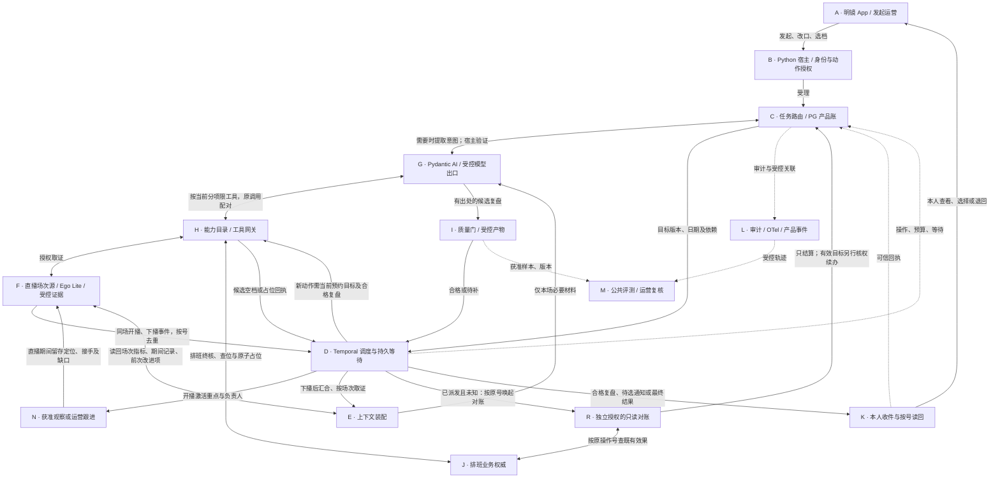

# 一句运营指令的调用关系

本图是首期接入设计，真实宿主、排班与收件端尚未联通。实线给出请求、可信返回或控制移交；虚线给出记账、异步观测和离线取样。为便于阅读，权限检查和操作账分别画一次，适用的每次业务 I/O 仍经过相应边界。各编号与下表一一对应。

| 节点 | 实际责任、权威记录与证据边界 |
| --- | --- |
| A/B | App 保管登录身份和本人入口；授权权威及对象责任关系来自宿主和资源方。受理解析出具体主体、场次、日期、服务对象和结果接收者，对用户显示。直接 API、确定性工作流与动态 Agent 对同一资源执行同等核权。E11 有单域实验，实际主体/接口待 W0。 |
| C/D | C 保存原目标、修改版本、分项、操作/尝试、原工具调用、预算和交付引用；模型可经 G 帮助 C 提取结构化目标，C 校验后落账。D 只安排可运行工作、挂起待选/待核；App 离开后由同一任务续办。E5/E12 有恢复切片；真实多要求路由和业务回执待验。 |
| N | 开播事件按组织、主播、场次与事件键去重后开始跟播。获准观察入口或有权运营接收本场具体重点，直播中记录观察者与时点、证据引用及接手状态。下播后用场次键与 Ego Lite 指标汇合。未采到或未接手时保留缺口；核对首次激活与观察时点后才可判定跟播实际发生。目标宿主尚未实测。 |
| E/F | E 只为本场本目的选择引用；F 中开播/下播和指标回场次权威核查，时间点回获准片段或运营记录，历史调整回上次确认复盘。公共数据层保存发布状态和来源位置。只有启用资料问答才接经治理的 RAG；排班空位由 J 提供。Ego Lite 键鼠问题由业务明确已解决，媒体证明力与实际来源待验。 |
| G/H | G 固定模型/提示词/工具版本，每一轮在发送前持久认领；H 从当前可见目录找能力，核参数、主体、预算及外发，返回结果配原调用。对本例的新查位/占位还要同时核对当前预约子目标版本、合格复盘版本和目的；受理或复盘模型阶段无法经 H 提前查约，直接业务入口依其自身任务契约核权。读取、发模型、发工具、正式提交、受限交付/再次兑换各核当前权限。业务源、排班和收件服务各对其动作执行最终检查。E5/E10/E11/E12 为隔离样本，真实端点责任待 W0/MVP。 |
| I | 质量门读获准的原文位置、指标及版本，生成合格复盘或列待补项；PG 记规则版本、判定及产物引用，正文存受控载体。E6 的独立函数和 E5 的负例可复用，运营验“能指导下一场”仍待业务试用。 |
| R | 既有操作查账走独立最小权限和原操作号，适用于取消/撤权/资料更正后的未知操作。只更新操作事实和预算，不新占位、不驱动已撤销预约的下游交付。原目标仍有效时，C 按现行授权、质量、目标版本重判是否恢复。E10/E12 有隔离样本；实际业务查单权限待核。 |
| J | 排班系统保管空档、冲突、原子占位与改期结果；占位成功就是生效，无接单环节。请求一旦由下游合法接收，应按原号核结果；收到超时只把产品操作记为未知。有效预约、时段和化妆师须从 J 读回。现无真实排班证据。 |
| K | 本人收件服务保管交付号、接收状态和已收内容/版本；部分复盘先送与最终合并送达各有独立业务键。主链验收要从本人入口读到符合当前权限的内容。产品账保存回执引用，点击反馈另记。真实接收端待接，W0 仍为 0/16。 |
| L/M | L 的审计与收据在持久账；OTel span 答“卡在哪”，PostHog Cloud 的显式事件答“在哪一步退回或明确放弃”。模型和工具的起止、版本及失败在各自边界发 span，使用受控内部关联键。M 用获准、版本化样本与脱敏轨迹评测，运营判断建议可用性。P1 AT11 有追踪导出故障记录；首期埋点接通、业务评测和各角色视图未知。 |

**读图示例。** 只要求复盘时，D 将合格复盘送 K。K 按交付号查实本人入口的内容后，原任务才记为送达完成。收件未知时按原号查，期间排班读写和预约通知均为零。下午全满时，J 返回空档，由 K 先交复盘及可选项；运营在 A 选择，C 记录同一任务的新输入，再从 H 重新核权与查位。预约已生效而回执未记时，D 挂起，由 R 按原操作查 J；若已撤权/取消，通过受限对账只结算既有效果。持久化预留直至取得可信终局；不因超时释放预算或再次提交。完整正负例、业务运营判断和待定规则分别见[产品范围](../requirements/first-mvp-product-scope.md)与[组件选型](whole-product-component-selection.md)。
