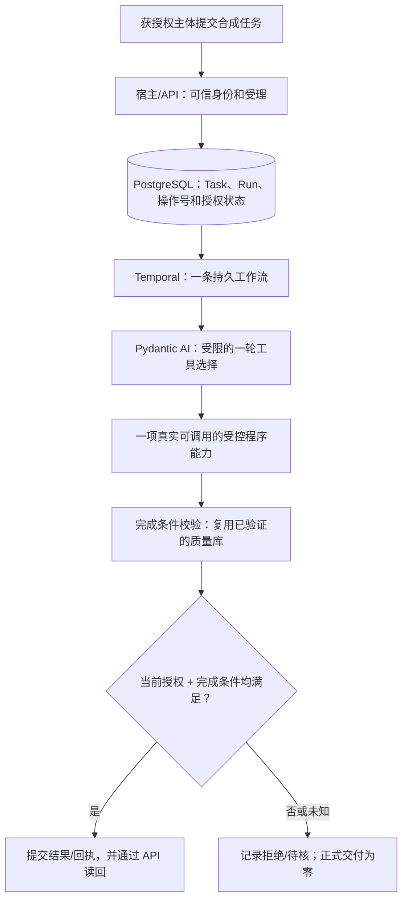

# 路线 B 最短端到端链路与正式 MVP 边界（评审草案）

- **状态：候选方案；未独立评审，未授权开始实现。**
- **基础：**完整需求原件 v0.4.1（SHA-256 `75ac634a98393b5f99fb28901a6a91bc7431290143b6458bbf1f9a2af5f23062`）、[实验结论](https://github.com/zhuquanwei111/mingjing---agent/blob/553114d2114cc77081c415ad1697e74be282c9a8/lab/architecture/DECISION.md)、[路线 B 候选开发包](https://github.com/zhuquanwei111/mingjing---agent/pull/6)。
- **先区分两种交付：**Walking Skeleton（W0）验证新架构的真实集成；MVP 是目标用户能够完成的第一项有价值业务任务。**W0 通过不等于 MVP、生产或全部 v0.4.1 验收通过。**

## W0 · 最短正式集成路径（待独立审查其必要性与最小性）

**边界：** 只做**一个中立、确定输出的小任务**，只使用合成租户/身份、合成数据和一个无真实外部副作用的工具。按获批准的项目环境启动真实 HTTP/API、PostgreSQL、Temporal Server/Worker 与 Pydantic AI 工具回路，不以仅有 mock 的多个模块相连冒充贯通。CI 可采用确定性测试模型验证协议与工具路由；若采用真实模型必须另行明确账户、费用、数据边界及兼容测试，当前不擅自授权。运行时只有一个任务和一个必要工具，不预先建设 RAG、模型网关、多个业务模块或完整 UI。

**复用与隔离：** [PR #6 的质量判定库](https://github.com/zhuquanwei111/mingjing---agent/pull/6)可在确认契约兼容后复用；旧 P1/P2 的数据、任务、Worker、迁移、凭据和在途任务均不得直接被 W0 接管。为 W0 使用单独目录、数据库/命名空间和隔离资源；不删除旧实现。复用公共业务契约前先确认它不是旧执行器的隐藏依赖。

## W0 必须产生的可观察证据

| 编号 | 关联需求 | 最小可重复验收（本轮只定义，不声称已完成） |
| --- | --- | --- |
| W0-01 | FR-01、25、26；AC-01 | 从 API 提交一个带可信身份的中立任务，返回 Task 与 Run，PostgreSQL 真实持久化，并在新进程中查询得到状态与结果 |
| W0-02 | FR-03、06、07、10–15；AC-02、04 | Temporal 实际启动/执行，Pydantic AI 经指定模型适配走真实的 Agent/工具调用接口，受控工具回执进入质量判定；证明有真实组件调用而非逐段模拟 |
| W0-03 | FR-24、36、38；AC-15 | 工具成功但缺少必需证据/引用不合法时不能标完成或交付；完整正例能正确交付，记录是否就绪和原因 |
| W0-04 | FR-32、33；AC-06、13 | 无权/跨租户请求不能进入受保护工具；在执行期间撤权后，后续读取、模型/工具外发、正式写入与交付按各自边界被拒绝；负例按实际访问日志与收端计数核对 |
| W0-05 | FR-28–31；AC-08、14 | 至少一个确定的工作流等待点终止 Worker 后重新启动可恢复，重复操作不产生额外正式提交；外部结果未知与取消不伪造成功。若 W0 未接入真实外部供应商，明确仅验证合成副作用与内部恢复 |
| W0-06 | FR-35；NFR-08 | API/Temporal/工具/结果串联 Task、Run、操作号与执行状态，能从真实日志/数据库回查；敏感字段不完整外泄 |
| W0-07 | FR-41；NFR-06、09、11 | 独立干净环境按固定版本启动并复验，失败返回非零，资源只清理本任务；旧 P1/P2 回归不下降，正式 CI 检查匹配目标架构 |

**判定方法：** 任务入口、实际 API 请求、数据库行/收据、Temporal 运行与历史、工具回执、质量判定、结果读回、对应 Git SHA、命令与退出码和完整 CI 日志必须相互对应。W0-05 等未覆盖的实际外部边界明确保留为后续验证，不得拿一个合成示例证明生产 exactly-once、任意中断恢复或生产安全。

## 建议的最小开发顺序（仅在方案通过后启用）

1. **架构准入。** 新上下文 Reviewer 按冻结原件和候选材料审查路线 B，原设计者处理阻断及必要修正，用户批准实质取舍。
2. **W0 契约与环境。** 明确一项中立任务、可信身份、稳定操作号、工具契约、完成条件、输出状态及资源归属；按规范写任务账、ADR/设计差异与失败验收。
3. **最短纵切实现。** 按可构建、可回滚的小增量，先走 API → 持久任务 → Temporal → 受控 Agent/工具 → 质量门 → 持久结果 → API 读回，验证新路线核心接口。各次修改独立代码审查。
4. **风险反例和恢复。** 在目标架构上验证撤权、交付缺项、重复/未知结果、进程中断的最关键实际路径；记录不适用的负例及原因。
5. **PR 和交付。** 对当前候选做测试、独立代码审查及修订、正式 CI、验收与人工合并；不自动发布，不拿历史实验结果充新代码运行证据。

如果独立架构评审认为上述链路仍过宽，可以拆成 **W0a（无模型的宿主/工作流/工具/结果闭环）** 与 **W0b（在相同授权契约上接入真实 Pydantic AI 工具循环）**；但**未完成 W0b 不得宣称路线 B 的 Agent 组合已集成验证**。在拆分后仍要尽早运行一次完整 W0，避免长期只交付孤立组件。

## 首期正式 MVP：需要独立确定业务价值，不等于 W0

完整 v0.4.1 明确**不预先锁定具体行业、岗位与首期业务范围**。目前不能擅自把 W0 的“合成任务走通”命名为正式 MVP。下一步应由项目与产品负责人确认**第一类真实用户和一条有价值的受控任务**，将其写成可复现的用户路径、正负验收、操作权限、非功能目标和可用范围。候选最短用户路径可表述为：有权用户发起任务 → 获准能力完成可确定工作 → 返回可说明来源与状态的结果 → 按权限查看历史；具体业务和发布方式仍待确认。

MVP 验收至少要证明真实宿主入口、身份与权限、必要数据与工具、完成条件、可解释结果、主要失败/恢复、最小观测，以及获准用户能实际完成目标。性能、并发、成本和正式流量准入指标从实际业务和环境测量取得，不使用自造阈值。完整产品既定能力（资料/RAG、可扩展工具、评测/数据治理、父子任务与预算、模型路由等）保留在分阶段路线图，不因 MVP 小就删除。

## 本方案需要独立 Reviewer 作出的判断

- W0 是否真为**最短**且覆盖路线 B 的关键集成风险？哪些能力应后移，后移是否造成关键架构无法验证？
- 首次正式代码开发选择质量判定库是否可保留，其必要性/接口是否被过度设计？
- 拟用 Temporal/Agent 的最小权限、可恢复点、运行成本、复用 P2 与退出历史机制的真实风险如何处理？
- 方案在取得完整需求原件和关键选型证据之前能否成立？哪些疑问必须以受控 Spike 实测？
- 是否有合理的最小真实用户用例可作为 MVP 起点，哪些必须交用户决定？

**门禁：** 未取得独立架构评审与用户需要做的关键选择，W0/MVP 均处于待审方案状态，禁止按本页启动编码。