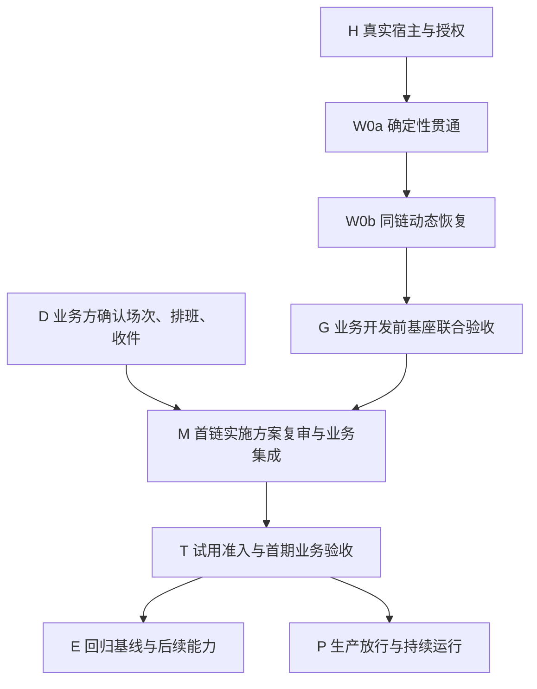

# 明镜智能体完整产品分阶段实施方案

**当前状态：供项目方决定建设顺序的设计。** 路线 B 的架构决定已合并。正式 W0 尚无真实宿主通过记录（A1–A8、B1–B8 均待验），首期受控知识库、基座联合验收、真实场次与预约效果也待验。每次开工、试用、放量按相应负责人授权。日期、资源额度、目标容量和可用性指标以项目方决定及测量为准。

[逐项查 23 组／76 项的前后两层证据](../requirements/whole-product-phase-index.md) · [架构终裁](whole-product-decision.md) · [PR #14 验收与历史证据](../requirements/whole-product-acceptance-results.md)

## 从哪里接续

| 有效依据 | 本方案沿用的决定与版本边界 |
| --- | --- |
| v0.4.1 全文，图 1、第 3–7 章；原件 SHA-256 `75ac634a98393b5f99fb28901a6a91bc7431290143b6458bbf1f9a2af5f23062` | 控制、执行、数据与能力、治理与观测四个逻辑面。按原第 7 章，调研和选型已有阶段性裁决，以下从真实集成排到运营加固和持续扩展。原验收观察量继续有效。[冻结表](https://github.com/zhuquanwei111/mingjing---agent/blob/52208b482fab9c74b3193a9789a0ff0abf2f5d99/docs/requirements/route-b-w0-acceptance.md) |
| [已合并的 PR #14](https://github.com/zhuquanwei111/mingjing---agent/blob/ef8bb05c79d02004d66e48e5ee8dc55c5491c723/docs/designs/whole-product-decision.md) | #5、#6、#10、#11、#12 等只在原样本范围内复用。未知派发保留预算、工具按原号恢复的隔离实测见 [#12 原始记录](https://github.com/zhuquanwei111/mingjing---agent/blob/300868efab379fa53ef0c49065b5cb6de36594ac/lab/product-review/round-gate/RESULT.md)。 |
| PR #18 [W0 宿主契约](https://github.com/zhuquanwei111/mingjing---agent/blob/8095d6f79e2e4e42fbdef03c8fdbfdf6b4785b35/docs/designs/w0-host-design.md)、[逐场景回执模板](https://github.com/zhuquanwei111/mingjing---agent/blob/8095d6f79e2e4e42fbdef03c8fdbfdf6b4785b35/docs/designs/w0-host-acceptance.md)、[独立评审](https://github.com/zhuquanwei111/mingjing---agent/pull/18#issuecomment-7105222681) | 引用已审 SHA `8095d6f`。PR 已关闭且未合并，模板是待填的运行记录。该 PR 的早期 MVP 草案已由后续三份定稿更新。 |
| `MVP-SCOPE-COMP-01` 的三份定稿：`first-mvp-product-scope.md`、`whole-product-component-selection.md`、`mvp-operation-call-graph.md` | 受控交接件《明镜智能体 · 首期 MVP 范围与通用组件选型》保存正文；三稿 SHA-256 前缀分别为 `ed8ff831bd1e`、`d7cf1627004b`、`06156861308a`。当前核对的 main（`52cadeb`）未归档三份同名定稿。接续用同一评审版，受控材料由项目方提供给有权开发者。 |
| `MJ-COMMON-BOUNDARY-02` R5，首期通用基座图及 23 行组件表 | 受控交接件《明镜首期通用基座_架构图与选型表.zip》，SHA-256 前缀 `1cf2210f717d`。以其中“首个可运行版本／最迟可用时点／第一条链路／取证处”安排 G 和试用。 |
| `MJ-CAP-ONBOARD-03`，[PR #19 固定开发者指南](https://github.com/zhuquanwei111/mingjing---agent/blob/6a9b57526ebe84402d021148dd6ff5b3e50fd686/docs/designs/whole-product-decision.md#capability-onboarding) | 引用已审设计稿 `6a9b575`。四类实现、三种入口、异步写入开放条件、停用及 AC-17 取证沿用此稿。PR 尚未合并；公共机制的目标实现与旧样例须分开核对。 |

### 工程依赖与阶段证据

D 可与 H、W0 并行收集，不提前做业务功能。E 与 P 按不同触发条件推进，生产发布只依赖本次发布范围和相应目标环境验收。每个阶段归档固定提交、环境和配置、数据版本、各权威方的读数、失败及复验。授权、隔离、未知副作用、虚假完成任一硬项失败时封闭该出口，标记阻塞、责任方和重验入口。更新[文档索引](../index.md)、任务记录及受影响的运行手册，依项目规范独立审查。原始业务材料留在受控环境，PR 记录可复核的脱敏证据与访问负责人。

| 面 | 写入或放行的权威方 | 后续开发者使用的接口 |
| --- | --- | --- |
| 控制面 | App 身份方给测试主体。对象、动作、用途以资源方当时授权为准。Python 宿主以 PG 保存 Task/Run、分项、目标修订、版本和启动意图 | App、受保护 API、有来源的业务事件共用受理和原任务查询/续办。直接程序可零模型；等待、依赖和故障恢复进 Temporal；仅需推理的步骤进 Pydantic AI。 |
| 执行面 | Temporal 历史证明调度与等待。产品账持久化原模型轮、工具调用号/消息引用、操作和预算。模型输入只装入当轮仍获准的上下文 | 每次对外派发从已登记出口走，写入前校验契约与业务条件、向模型或工具发送前分别核权。模型提出的工具选择必须经过目录和执行门。 |
| 数据与能力面 | 实时业务事实、原操作号终局由业务方保存；资料发布者决定可用版本。产物库保存受控版本和引用；本人收件端按独立交付号保存收据 | 检索、按号查单、按版读回各有用途。会话历史、摘要及工作流日志均不能作为已占位、已交付或当前获权的依据。 |
| 治理与观测面 | PG 审计与预算能逐笔核对；OTel 用于排障，产品事件用于分析；在线质量门使用业务规则，离线评测由独立参考与样本给出判定 | 以 Task/Run 串联授权、操作、质量、收件、费用与版本；受限正文和凭据留在允许的边界。采样失败仍能查业务事实。 |

## H 与 D · 先拿到真实权威

| 阶段 | 进入条件 | 工程工作与依赖 | 交付物、通过条件 | 通过后 |
| --- | --- | --- | --- | --- |
| H · 真实宿主 | 架构设计已审，可做承建决定和接口核对 | 项目方指定承建项目和负责人，界定最小建设范围：正式受理/测试登录、对象权限源、受控业务提交及原号查单、独立收件与原交付号查询/本人重开。宿主方和运维准备隔离租户、可重启 Worker、持久 PG/Temporal、受控模型、存储和可注入故障的收端。 | 联调清单填项目、人员、接口/版本、有效测试身份、授权边界、实读入口和环境摘要。能登录、授撤指定对象、分别查询两种收据，能单独重启并从各端取证。缺任一权威或仅有本地替身，H 未就绪。 | 项目方明确批准该目标后实施 W0a。 |
| D · 首期业务输入 | 有已审产品范围，可与 H 并行 | 产品方联系实际运营、跟播证据源、Ego Lite 取数方、排班及本人收件负责人，逐条回答下文待决事项；确定哪些动作能在测试租户、哪些仅能在经授权的试用中做。 | 有姓名或项目归属、样例和合法用途、时区和下午边界、可查收据接口、必需证据和改约权限清单。限定试用范围，双方确认可观察的业务结果与需封闭的动作。 | 把答复与真实 W0 回执带入 M 的实施复审。 |

## W0a、W0b · 按原契约执行

| 阶段 | 进入条件及工程工作 | 接口与交付物 | 可观察通过条件 | 通过后 |
| --- | --- | --- | --- | --- |
| W0a | H 就绪且已获准。同一受控任务由真人测试身份提交，事务写 Task/Run/唯一启动意图，Temporal 执行固定证据核对，质量合格后按操作号提交业务，再按交付号收件。模型调用为 0。 | 身份及真实 ACL、两项受控事实、业务提交/查单、本人收件/按版再次打开。提供 A1–A8 逐例输入、故障注入点、PG、引擎、业务方、接收方原始计数。 | 正常路径唯一效果和唯一收件；缺项及越权不派发；竞争启动仍为一个逻辑工作流。业务已成而交付失败显示部分完成。两端分别在“已生效、未记回执”处断连，按原号查；未知不盲重发。收件后撤权，旧引用取不到新内容。八项逐条通过。 | 进入同链 W0b。若业务或收件端不能查证，修宿主/适配器并重验。 |
| W0b | A1–A8 全过。只将找证据环节加入动态决策，其余业务门和收件沿用 A。跑 0/1/2 工具、三入口正反例、真杀进程、授权竞争、预算耗尽及两个实际构建并存/回退。 | 受控模型/工具实际接收端、共享预算、产品回合账与消息引用、Temporal 唤醒、版本路由和 W0a 各权威方。提交 B1–B8 回执与最终同一构建组合上的 A+B 全套复跑，再做独立复核。 | 模型已收未记，单轮只接收一次，未知保留预留。工具已生效未记，按原调用和可信收据续原会话一次；B3 正常样本的发送/效果/工具模拟费/模型请求/交付为 1/1/1/2/1，撤权或取消样本为 1/1/1/1/0。五处核权、真实版本回退及其余断点按原表判定。模拟费仅证派发机制。 | W0 回执支持 G，并输入 M 方案。无法可靠续原会话、拦住失权外发或隔离旧构建时封闭受影响路径，复审模型适配、派发或版本路由。 |

## G · 业务功能开发前，让公共基座在一条任务上运行

**进入条件。** W0 最终组合已复核。数据发布方授权隔离测试资料与两组身份；宿主、数据、模型、评测与观察负责人可独立读取各自证据。同题试选、准备夹具可提前，签署本关口须绑定实际宿主及同一候选构建。

| 谁做、复用什么 | 同一候选必须交出的运行证据 |
| --- | --- |
| 任务和执行负责人复用 A/B 的 PG、Temporal、网关、Pydantic AI、目录 | App/API/事件三入口可受理；合成多目标测真/假/未知、有限并行、删一保一、离开后找回。直接路径零模型，工具只出现于适用且已发布/获准的目录。测重复派发、共享预算竞争、未知占额及停接。提供同步和可挂起能力的契约自验入口。 |
| 数据与知识负责人运行一条真实受控数据通路，复用来源登记、获准采集、清洗与单位、去重、质量、发布版本、保存期及受控存储 | 对照两个租户、相似资料、未发布资料、v1→更正 v2→撤回，实际查到正确页段/来源；测试缓存命中、旧引用再开、索引故障、模型实际获准输入和已交付引用。源不可用或无法确认版本时阻断相应使用。 |
| 宿主、模型与安全负责人按对象和用途组装上下文 | 双对象夹入无关历史、摘要及不可信资料/工具输出。查真实输入，未混入其他对象；工具请求/结果成对，给输出留量；关键事实从权威版本回查。验证五个出口的拒绝、凭据/网络边界、状态恢复与审计脱敏。 |
| 运行、评测、收件负责人在**同一失败 Run** 上分别取证 | 先合法检索并定位原文，再撤回资料，让缓存或旧引用再次用于同任务。阻断后续失效使用、写入和交付。给另一名排障者只提供任务号，由 OTel 加持久审计找出在哪次调用、哪版来源失败。将同一运行的受控引用作为离线样本，用独立来源清单/预期命中已知错版。记录数据集、模型、提示词、工具、规则、重跑命令及逐例报告。再跑同构建的合格对照，业务端、本人收件端均可读回正确版本。 |
| 发布、运维与产品分析负责人复用构建锁和事件字典 | 依赖健康/就绪、启停、换进程和基础隔离及限额可观测。检查产品事件最小字段、业务确认后产生、去重和可核查的本地出口。试用前再核 Cloud 入站。 |

**交付与放行。** 交付对照选型记录、带版本的公共接口与样例、可重复的联合用例、同构建失败和成功两份 Run、评测报告及独立取证记录。没有真权威、失败原因追不到、评测检不出已知错项、撤回后还能输出、或合格结果无法查收，均须修复后复跑。G 过关和 D 有答复后，才可按 M 的复审结论批准首个业务功能开发。

## M 与 T · 首期正式业务

| 阶段 | 进入条件 | 工程工作、权威接口 | 交付物和可观察通过条件 | 通过后 |
| --- | --- | --- | --- | --- |
| M · 实施复审与首链集成 | G 已通过、D 的必需业务输入已确认。W0 实测结果、限制和修订进入首期实施稿，产品方确认范围，**独立复审通过并另获实施批准**后开发。 | 一次受理绑定运营、主播、场次及业务时区的绝对日期。正式开播事件唤醒原任务，获准观察者/采录从开播跟进；下播后用 Ego Lite 取数，与同场可定位证据汇合。检索规则/佐证、回查上次确认记录，在线校验复盘；合格后按用户指令发起次日下午最早空档的原子预约。调用身份、数据、模型、目录、追踪和预算复用 G。 | 提交业务适配器、质量规则、排班与收件契约、脱敏用例及真实接口的测试租户对账。跨午夜仍为受理时确定的日期；只有全场指标时开场行为待核；关键材料缺失不预约；只复盘则排班查询/写入均为 0。下午已满可先收复盘及可选时段，回到原任务续选。改口只取消预约分项；已生效则显示真实预约并按权限另办。争同一化妆师同档仅一条有效记录，改期抢位失败保留原单。 | 业务实现可进入 T 的试用准入核查。 |
| T · 有限试用及 MVP 完成 | M 用例在真实接口测试租户通过。首批运营、允许场次、可写排班和收件对象获批；先执行本行的**试用前**检查。 | 在拟试用环境分别测交互、后台等待任务、模型和外部采集/排班，冻结试用承载范围和停止条件；恢复备份，核停接、在途版本和回退、保留待核；用授权样本冻结基准、分母/判断尺度。核 PostHog Cloud 获准事件入站、删除/留存和脱敏，OTel 失败仍有业务审计；有真实结算的资源与供方账单抽核。上述通过并经业务/运维同意，才进入实际试用。 | 真实授权场次复核跟播是否在时、事实、出处和下场建议；排班权威按操作号数实际有效预约和冲突/改期结果；指定运营从本人端按交付号开同版成果。由实际运营分别验复盘、预约，再验整句原意；核脱离 App 后续办、并发人工跟进冲突及交接的发起/接受/完成。记录原流程耗时、返工原因、争抢/重复占位、缺证和异常分母；附原业务规则、逐例通过/失败、用户签收和有权业务判定。未获准在实务中注入的故障保留测试租户证据并标边界。 | 业务方确认 MVP 达标后，立即进入 E 的基线回归；拟扩大流量或正式上线则同时准备 P。首期范围未达成须保留失败和复验责任。 |

## 首期 MVP 完成之后

**第一项具体工作（E0）。** 首次业务签收后，评测负责人和一名实际运营把该版的合格复盘、证据不足、无空档续办、占位冲突及迟到回执整理成有授权、可回放的样本。真实材料不能复用时采用保留断言的受控派生样本并标来源与适用边界。冻结版本、分母和预期，用 G 的评测命令跑一次基准和一次植入错证据或重复效果的负例，逐例从来源、排班和收件账核对。交付固定数据集、报告、差异和责任人；正确对照通过、已知错误被抓到且可重复后，下一次改模型、提示词、业务规则或接第二能力就有共同回归起点。

E0 以外的工作按事实触发。评审记录选择了哪一行及原因。基础链达到稳定条件即登记 E1 验收，不能拿既定 MVP 样例替代；若更早已稳定，可提前独立开展。上线 P 只核本次对外开放的范围，按目标负载和数据责任单独放行。

| 阶段与启动条件 | 谁建设、复用哪些接口 | 交付物和可观察通过条件 | 通过后可开展什么 |
| --- | --- | --- | --- |
| E1 · 独立能力接入。基础链故障/撤权/恢复和回归可重复，版本及公共边界可封存；最迟首个未知实现类型放行前 | 未参与首期/该能力的开发者按 PR #19 的接入指南，先封存公共核心、注册装配与能力私有目录指纹，再独立选择未专门适配的业务中立能力。提供版本化 Schema、数据权限、副作用、预算、终局、错误与取消语义。同步程序/业务 API 当次返回，工作流由 Temporal 调度，Agent 受控选工具，外部异步服务分受理/完成、按原号查询，回调校验归属后对账。 | AC-17 报告存前后 SHA、完整 diff、各公共修改的理由、原收端效果、负例及提问。三入口里至少两种适用入口实测，其余适用也验；同能力同版本、确定性零模型、动态配对。测无权、超时、重复/乱序、停用和回退。不能可靠去重或查终局的副作用限制到受控查询/草稿或转人工核实，禁止自动重发/宣称完成。仅业务适配/登记且全部达标可判标准接入；确需修改核心，先复审受影响契约和旧能力回归后重新裁决。 | 放行本类接入，更新模板和能力目录；记录实测改动量。 |
| E2 · 公共数据与知识扩展。出现第二业务来源、第二消费方、新媒介或更正撤回时限改变 | 数据方复用 G 的来源登记、标准化、质量、发布清单、授权检索和按版产物读回；业务权威保留实时事实。新建必要的解析/定位、单位映射、去重、版本迁移和保留策略。索引/嵌入版本变更走并行重建及切换。 | 交付源契约、迁移与回退样本。另一租户相似材料不可见；新旧版本、表格单元/媒体时点可回原文；撤回在索引、缓存、旧引用、再次打开和下一轮发送全部生效；消费方能追溯更正且原始事实不被改写。 | 把该来源开放给批准的业务；失败只封闭该版来源与其衍生产物路径。 |
| E3 · 上下文加固。出现跨日长任务、第二业务对象或超窗/误混入的实测退化 | 上下文负责人复用用途授权、配对工具周期、版本化引用、产品检查点；在新负载试裁剪与分层摘要，保持权威回查。 | 同长任务中混入第二对象、过时事实和冲突摘要，捕获真实模型输入、恢复检查点与最终结果，验证必需事实准确、无越权字节和误用、原调用成对。对照质量、用量和成本后放行。 | 新任务类型可复用该策略。确有跨任务长期偏好需求时另启 E4。 |
| E4 · 条件性长期记忆。业务提出可衡量的跨任务偏好用途，主体、写权限、保留期及撤回权已明确 | 产品/数据治理方先比较受控 PG 偏好与现有按号取上次确认事实的路径。记录谁在何时确认、适用范围、到期及删除责任。 | 交付准入与清理规则；按用户/组织测试更正、冲突、撤回、过期后重建上下文和旧缓存，本次明确指令优先。从审计与实际模型输入复核。 | 仅在获准用途启用。未触发期间依原业务事实跨场续办。 |
| E5 · 公共评测与运行治理迭代。模型/提示词/工具/策略升级、新事故、预算/计费单位变化或新业务启用 | 评测负责人把事故加进 E0 样本；运行与账务复用 PG 共享预留、OTel、按角色审计及供方对账。对比新旧构建的质量、无进展停止、公平排队、成本和尾部失败；预算未知项保留至原号可信终局。 | 交付逐例差异、授权/费用差异单、兼容与回退报告。预定硬负例全拦住，正常样本可完成，重复回执不重复核销，超阈值回退或限制能力；业务签认质量差异。 | 放行本次改动，更新运行手册和下次回归样本。 |
| P · 上线、扩容与灾备。第一次正式流量、扩大试用范围、迁区或目标负载/拓扑改变 | 运维和业务方根据 T 的流量分布确定四类资源的目标、SLO、可接受成本、RPO/RTO、停止线、负责人。混合压测长短请求/跨租户、模型限流、采集器争用；演练停接排空、在途兼容、回退，以及产品 PG、Temporal 历史、产物/索引和密钥的目标环境恢复。上线后按变更或约定周期复演。 | 目标构建、压测曲线（吞吐、分位时延、积压和拒绝）、资源账单、备份和还原记录、丢失窗口与实测恢复时间、异常清单与放量签认。恢复后按业务/交付原号对账，待核保留、无重复效果，旧权限或撤回版本不能复活。任何硬项超界，缩小范围/修复再验。 | 仅放行测过的流量与灾备目标；新的容量、费用、服务目标返回本行重测。约 300 人是潜在用户数。 |

## 未决事项、组件决定人和最迟时点

这里登记的是责任角色。现有材料未提供可核验的现任人员、正式服务地址或建设承诺。项目方在下表指定真实项目、人员、接口版本、授权/测试入口、决议和证据位置后才可将对应项标为就绪。

| 何时决定 | 依赖、决定和负责人 | 关闭依据；失败处置 |
| --- | --- | --- |
| H 前 · 实际宿主 | 项目方决定**由哪个项目承建**及范围；宿主团队提供正式任务入口、测试登录、原任务查询。身份/各资源方明确谁可授撤租户、对象、动作及用途。业务端提供原操作号提交/查终局；收件端另提供交付去重、查收据及本人重开。 | 逐一登记端点、责任人和可独立核对的测试账户/一次真实请求记录；缺少必需权威或执行许可，停在 H。若实际宿主不能支持已审边界，重审相应组件。 |
| G 前 · 单模型、数据、受控知识库与存储 | 模型负责人按获准端点、地区、工具协议、兼容、提示词版本和预算定单一文本模型；数据方定首个获准源、留存与受控版本存储。知识负责人在同题同权两租户资料上比较 **RAGFlow** 和 **Docling＋pgvector＋自有发布及授权适配**。 | 测正确出处、更新/撤回、缓存/旧链接、实际外发与故障，先冻结样本、必要硬项与判据；记录维护工作、接口/许可及部署实耗。都不合格则 G 阻塞。模型无兼容备用时安全停止，不自动切换。 |
| G 前与 T 前 · 评测、计量、运行记录及产品事件 | 运行/评测采用版本化样本、pytest/业务断言和独立判断；OTel 排障、PG 记审计和预算。产品分析在 G 建允许字段/事件字典，T 前验已选 PostHog Cloud 受控接通和留存。 | G 出具实际失败链与逐例报告；T 前有业务评价尺度、运营核对及云端实收证据。PostHog 的 AI 评测能力没有随产品埋点获准。 |
| M 方案复审前 · 证据与排班规则 | 实际运营和场次方定哪种获准片段/带时点记录足以判断开场动作，哪些缺失阻断预约；给开/下播事件和 Ego Lite 数据字段、时区、单位及可靠来源。排班方和业务方定原子占位/查单/改期/取消、主体与同一主播可否多占；本人收件方提供真实收据。 | 双方签原件/样例和成功判断。资源方确认化妆师无需接单；下午满先出复盘。强依赖缺失则暂缓首链实施；未定的可选操作封闭并登记，不擅定业务规则。 |
| T 和 P 前 · 使用规模、隔离和灾备 | 运营、运维、数据治理和财务以实际任务分布确定试用/生产负载、并发限制、质量/价值判定、恢复目标、预算和日期。供应商真实账单只在获准结算情形取证。 | T 在获准试用范围验，P 按目标环境再验。没有目标、数据或还原结果就不给出相应放量结论。 |
| 相应能力首次启用前同题决定 | 多提供方/代理有真实需求时评单模型路径与 LiteLLM 的协议、降级、重复计费和撤权；跨模型批量评测时比较当前入口与 Promptfoo；复杂动态灰度比较 Git/PG 基线与 OpenFeature 或 Unleash。跨组织细粒度策略/多方计费在现有 ACL/账无法满足时再比较独立策略/计量服务。 | 各负责人沿用同权限、预算、故障、可回退的场景及实测运维成本。未经验证的备用或渠道保持关闭；核心职责受影响才重审该层。 |
| 有业务需求才启用 | E4 长期偏好；需要运行第三方不可信代码时才比较专用隔离执行器；出现清晰的协作质量收益时才引入额外 Agent。已有受控适配器、有限并行和任务交接先用。 | 需求方提交价值、权限、生命周期和退出办法；首次开放前分别验证删除/撤回、网络凭据和取消隔离、协作收益与共享上限。首期不为这些事项预建平台。 |

**实施判断。** 团队可据此开始确定宿主和接口、准备验收及业务输入；正式 W0 依赖 H 和实施批准，首链业务开发依赖 W0、G、D 和 M 的独立实施方案放行。首期结束即有 E0 的可执行下一项，随后可以按 E1–E5 或 P 的触发条件定位负责人、接入说明、权威读数及复验范围。每一项的实际结果随阶段更新至需求索引及任务记录。
