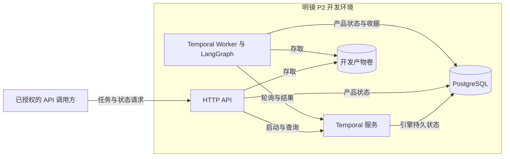

# 明镜接入 Codex 通用工程规范

明镜采用 [1.0.0-rc.1 候选包](../engineering-standard/README.md)及 [Python、Make 与 GitHub Actions 适配](../engineering-standard/adapters/python-github.md)。本页说明采用位置和已选择的项目规则，实测和限制见[任务记录](tasks/engineering-standard.md)，技术决定见 [ADR 0001](adr/0001-versioned-engineering-standard.md)。[可执行性审查](engineering-standard-execution.md)逐项记录入口、失败处理和验收方式。

## 当前实现与权威入口

| 查找内容 | 现有入口 |
| --- | --- |
| 当前阶段、公开入口及历史材料 | [根 README](../README.md)、[项目执行规则](../mingjing-codex-engineering-v1/AGENTS.md) |
| 当前 P2 公共层与契约 | [接口和运行方式](../core/README.md)、[版本与迁移](../core/VERSIONING.md)、[业务验收](../core/tests/test_core.py) |
| P1 验证与未放行项 | [隔离环境](../p1-walking-skeleton/README.md)、[P1 报告](../p1-walking-skeleton/P1_REPORT.md) |
| 任务与执行证据 | [长任务约定](PLANS.md)、[开发流程](development.md)、[设置与环境](configuration.md)、PR 和 CI |

下面是 P2 开发环境的容器视图。LangGraph 运行于 Worker。图中的 PostgreSQL 服务承载产品及 Temporal 所需的独立库，产物卷保存开发文件。业务权限、收据和持久状态的具体规则以[公共层操作手册](../core/README.md)与[Compose 配置](../core/infra/compose.yaml)为准。

## 最终效果优先与成熟工程能力复用原则

本原则适用于明镜完整产品的架构设计、技术选型、开发实施、独立评审及所有建设阶段。它约束通用工程能力的新增、实质替换和自研决策，不改变当前阶段授权或现行已批准的技术基线，也不自动批准任何候选、外发、采购、开发或上线。

**明镜把主要开发资源投入独特的业务能力。** 优先核对成熟应用已解决的工程问题，把开发投入业务逻辑、专业能力、交互和真实业务集成。采用成熟基础设施，不等于充分复用了成熟应用能力；底层技术成熟、可编程或可控，不能证明上层工程能力应由明镜自行开发。

### 选型与复用

- 最终实际效果优先，综合质量、可靠性、安全、适用性、集成、许可、运维及长期维护责任；不保护既有路线、代码或沉没成本。不预设完整成熟项目、组件组合、适配或必要自研必然胜出，不以开源/免费、项目热度、组件数量或控制自由度代替实际效果。
- 对实质技术取舍，先调查能够直接承担完整应用工程职责的成熟产品和真实集成实践，核对其原生实现、配置、公开接口与实际限制；再针对剩余缺口选择成熟专用组件或必要开发。不得仅因编程语言、基础框架和数据库能够实现某项功能，就默认安排自行开发。不得为了架构方框而拆毁原生完整能力、另建平台或部署重复职责的组件。
- 采用官方源码、文档、专业评测、具名企业实践、真实开发者集成与反馈、既有实验等适用证据作出合理工程裁决。区分证据版本、范围与未知，禁止跨层级错误比较、证据外推、虚构统一排名及以功能列表/Star 数替代效果。技术选型与实际集成、正式验收是不同阶段；不强制本机或全候选同题重复试验，仅对可能改变选择且可靠证据无法解决的问题安排获准的定向验证。未验证的实际安全、可靠性及质量仍须在采用路线按既定门槛验收。
- 收敛到有依据的主路线、必要补充、有限备选、未决风险及反转条件。没有实质改判问题不无限增加调研、实验或候选；条件性能力明确启用条件，不以 MVP 为理由延后已明确要求的公共基座。

### 复用、适配与自研边界

对新增或实质替换通用工程能力，在现有方案、ADR 或任务记录中按职责说明现成实现（项目、版本、具体模块/接口、证据）、以下采用方式、真实缺口、维护责任与改判条件：

| 分类 | 执行要求 |
| --- | --- |
| 原生复用 | 直接采用成熟实现，保留其有价值的完整能力，不另写等价功能。 |
| 配置实现 | 利用已有功能与受支持配置满足要求。 |
| 适配开发 | 通过公开接口、扩展机制进行必要集成，明确涉及模块、改动范围及上游升级责任。 |
| 必要自研 | 说明成熟方案为何不能合理满足要求、自研的必要性、预期收益、替代选择及持续维护责任。 |

不使用“薄适配”“必要二次开发”掩盖大规模公共机制重写；没有实测不虚构代码量、人天或维护成本。若需重写成熟项目核心、另建重复工作台/运行体系或长期维护 fork，先重新进行实质技术取舍与独立评审。必要业务语义与安全控制不因复用而免除。

### 执行和审查

- 设计者在进入实质通用能力实施前，将复用边界及证据写入现有方案、ADR 或任务记录。通过原生子代理、备用 CLI 或人工评审时，在送审材料中写明本节路径、对应 Git 提交和待核实的取舍。评审者回执应引用实际读取的条款和候选方案，指出成立的问题或给出通过理由。原设计者处理必要修正及阻断。实施者不得自行把未批准的重复建设写成既定任务。
- 独立方案评审检查完整成熟实现的覆盖与证据、剩余开发必要性、组件职责重叠和最终效果；代码/PR 审查检查实际改动是否越出已审复用与自研边界、是否重写已有成熟实现或重复增加组件。发现实质偏差返回原设计者或实施者修正，沿用既有反馈回流、复验与合并门禁，不另建评审系统。
- 普通小改动或修复未涉及实质技术取舍时，可注明不适用。实现已审方案时，引用原决定，核对实际改动及偏差即可。新需求、已选技术无法满足关键要求或出现足以改判的证据时才重审相关选择。减少重复建设不等于削减产品能力，也不降低必要安全、质量、可靠性及正式验收要求。

### 问题解决优先与上游修复复用

本条适用于架构设计、选型、集成开发、调试、故障修复和独立评审，覆盖已选的成熟产品、框架、组件及其依赖。发现问题首先以解决实际问题为目标，而不是立即换线、缩减需求、扩大自研或转交后续阶段。必要的安全止损（隔离、暂停受影响操作、防止数据泄露或重复扣费等）应及时执行，但不构成根因修复、能力验收或最终选型裁决。

对影响必需能力、安全、可靠性、兼容性或实质技术取舍的问题，按风险与证据缺口执行：

1. **定位问题。** 核对实际代码、固定制品与依赖版本、配置、接入方式、日志及可观察反例；区分本项目集成错误、上游版本缺陷、设计限制及环境问题。仅有猜测或一次失败不得直接判定技术不可用。
2. **查上游和工程实践。** 针对根因主动查官方文档、源码、Issues、维护者答复、PR、发行记录和回归测试，并参考有实际使用、复现或修复证据的资深开发者及成熟团队经验。核对相同问题、适用版本、修复合并及发布状态、实际接口和限制；Issue 关闭、PR 存在或营销描述不等于已解决。
3. **先复用解决办法。** 比较正确配置、受支持接口、已发布修复、安全兼容升级、成熟扩展、现成集成和必要局部补丁。未合并补丁可研究，不默认作为正式依赖。优先选择达到要求且长期维护合理的方式；评估许可、版本兼容、影响范围、升级与回滚成本。确需自研时说明现成方案为何不足，不因能写代码就重造成熟机制。
4. **验证实际解决效果。** 利用已有反例、测试资产和可靠外部证据，仅对决定性缺口安排获准的定向验证；保留失败与成功证据，核对必要安全、质量、可靠性及回归要求。不得通过放宽断言、关闭必需功能、使用模拟结果替代真实验收或将问题一律延期来宣告解决。
5. **有依据地收敛。** 合理排查并比较可复用的解决办法后，按综合效果选择可维护的合格方案。关键要求无法满足、修复需不可接受的大规模重写或长期维护负担，或已有可靠证据表明替代方案综合效果更佳时，可提出受影响范围的局部替换；确需自研时说明必要性。比较兼容性、许可、迁移与回滚成本及维护责任，按原有实质技术取舍、独立评审和授权流程决定。最终效果优先，不为沉没成本强保原技术，不因局部失败推翻无关技术，也不无限延长研究。

对一般小修复可按实际影响简化，复用项目已验证的做法；不强制每个小问题都进行全网调研或另写报告。对实质问题，在既有任务记录、ADR 或 PR 中保留问题与根因证据、核查的具体上游/工程来源和版本、可复用办法、选择及排除理由、实际验证、剩余风险与维护责任；复用既有记录而不另建总账。独立评审应核查是否已合理寻找并利用已有解法，是否过早换线、放弃必需能力或扩大自研；不把尚未解决的阻断写成已完成。涉及实质技术取舍的评审材料须包含同一提交的本条及相关证据。

本条不新增实施、数据外发、采购、测试环境或上线授权，不降低已批准需求、阶段门槛、真实验收及独立评审要求。

## 执行与证据

- **任务与审查。** 明镜沿用 [原生独立审查及反馈回流](development.md)。实质技术取舍优先使用项目级 [原生 `solution_reviewer` 子代理](../.codex/agents/solution-reviewer.toml)，不继承原设计聊天历史并核实材料收到及结论回流；**不要求强制只读证明**。原 [Codex CLI 关卡](../engineering-standard/adapters/codex-cli/README.md)作为备用路径，保留其现有失败拦截功能。原始需求与候选的材料和版本在任务记录给出。原设计 Agent 根据回流结果修订，必要时通过同样的独立评审路径复审；具体调用能否成功以当前客户端实际结果为准。接续时在工作区使用 `$engineering-handoff`，读取已有任务账与只读状态入口。原实施者负责接收、修复、复验、提交和更新 Draft PR，用户验收并决定合并。
- **本机检查。** 用 Python 3.10 或以上运行 `make check`，架构检查使用 `sys.stdlib_module_names`。若系统默认 Python 较旧，可用 `make check PYTHON=/path/to/python3` 指定已核验的解释器。`make smoke` 需要 [macOS 冒烟环境](../p1-walking-skeleton/README.md)，运行在独立目录和本机回环端口。
- **正式验收。** [实际规则集](https://github.com/zhuquanwei111/mingjing---agent/rules/27699996)要求默认分支通过 GitHub Actions 的 `P1 acceptance`。[当前接入基线的工作流](../.github/workflows/verify.yml)在原生 Linux ARM64 上跑 P1、重建恢复与 P2。amd64 作业提供辅助反馈。堆叠草稿的运行证明其现有目标及候选，切换至默认分支后需核对最新差异与该目标的合并门禁。
- **环境和恢复。** Mac M4 为主要工作区；Instabox x64 作为服务联调与复现环境，先确认在线和 `/data` 挂载、可用空间、项目位置与运行占用。Daytona 仅在任务选择隔离试验时使用，验证实例架构、Docker/Compose、网络权限、生命周期及清理。正式验收用已有 GitHub runner。Git 提交与任务账用于恢复，合成数据和临时运行资源各自归属于当前任务。
- **Codex 配置。** [项目默认](../.codex/config.toml)、Mac 用户层和当前会话权限分别核对。见任务记录的 C09，本轮读取 CLI 在原工作区与新工作区的实际层。会话继续按其当时生效的授权工作。
- **Space。** 当前连接可列出和搜索可访问 Pages，按“明镜”查询读取到相关个人页面的元数据。页面可用于讨论、链接、评论和呈现进展，项目的规则、ADR、源码和正式证据由 Git 提交与 PR 管理。需要把讨论结论纳入规范时，在有授权的 PR 中写入内容，之后按许可更新页面摘要及版本链接。当前采用流程使用明确的链接与更新动作。页面内容、访问权限和共享由页面维护者决定。[Space 官方说明](https://learn.chatgpt.com/docs/space/pages)

## 供应链证据与运维界线

| 对象 | 可核验版本、来源和验证 |
| --- | --- |
| GitHub CI | `actions/checkout` v6.0.2 的完整提交由 [工作流](../.github/workflows/verify.yml)固定。该作业 `contents: read`，checkout 不持久化凭据；[上游发布](https://github.com/actions/checkout/releases/tag/v6.0.2)与[许可](https://github.com/actions/checkout/blob/de0fac2e4500dabe0009e67214ff5f5447ce83dd/LICENSE)可核对 |
| Python 3.12.16、PostgreSQL 17.12、Temporal 1.32.2 | [P2 操作入口](../core/README.md)记录版本，[镜像构建](../core/infra/Dockerfile)及 [Compose](../core/infra/compose.yaml)固定来源与多架构摘要。上游许可分别见 [Python](https://docs.python.org/3.12/license.html)、[PostgreSQL](https://www.postgresql.org/about/licence/)及 [Temporal](https://github.com/temporalio/temporal/blob/v1.32.2/LICENSE) |
| Python 依赖和 macOS CLI | [P2 ARM64 lock](../core/requirements/linux-aarch64.lock)、[amd64 lock](../core/requirements/linux-x86_64.lock)以及构建安装的 wheel 哈希和 `pip check`；[P1 macOS 运行说明](../p1-walking-skeleton/README.md)固定 Temporal CLI 版本及归档 SHA256。[P0 报告](../mingjing-codex-engineering-v1/P0_REPORT.md)有核心依赖许可的历史核验 |
| 制品安全与发布 | [历史镜像扫描](../p1-walking-skeleton/evidence/lima/image-scan.json)及 [P1 报告](../p1-walking-skeleton/P1_REPORT.md)保留安全待办。当前开发验收验证目标架构运行、特定行为及恢复。生产所需的许可清单、制品安全和环境放行沿用项目门禁 |

本次接入使用现有服务和运行命令。项目维护者合并后按任务授权核对主分支检查，运行故障参照现有运行手册处理。规范反馈写入任务记录，由项目维护者决定应更新通用标准、技术适配或本页。复用包如需向其他所有者分发，由权利人确认项目及所引用材料的许可。
