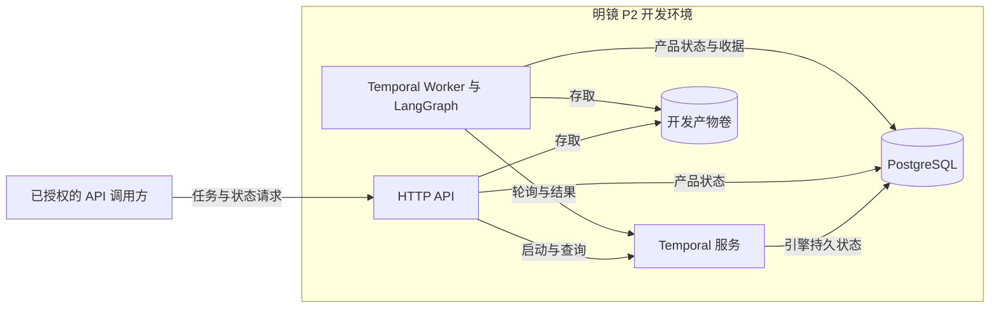

# 明镜接入 Codex 通用工程规范

明镜采用 [1.0.0-rc.1 候选包](../engineering-standard/README.md)及 [Python、Make 与 GitHub Actions 适配](../engineering-standard/adapters/python-github.md)。本页说明采用位置和已选择的项目规则，实测和限制见[任务记录](tasks/engineering-standard.md)，技术决定见 [ADR 0001](adr/0001-versioned-engineering-standard.md)。[可执行性审查](engineering-standard-execution.md)逐项记录入口、失败处理和验收方式。

## 当前实现与权威入口

| 查找内容 | 现有入口 |
| --- | --- |
| 当前阶段、公开入口及历史材料 | [根 README](../README.md)、[项目执行规则](../mingjing-codex-engineering-v1/AGENTS.md) |
| 路线 B 新开发 | [v2 开发包](../mingjing-codex-engineering-v2/README.md)、[ADR 0002](adr/0002-route-b-foundation.md)、[任务账](tasks/route-b-foundation.md) |
| 兼容维护中的 P2 公共层与契约 | [接口和运行方式](../core/README.md)、[版本与迁移](../core/VERSIONING.md)、[业务验收](../core/tests/test_core.py) |
| P1 验证与未放行项 | [隔离环境](../p1-walking-skeleton/README.md)、[P1 报告](../p1-walking-skeleton/P1_REPORT.md) |
| 任务与执行证据 | [长任务约定](PLANS.md)、[开发流程](development.md)、[设置与环境](configuration.md)、PR 和 CI |

下面是 P2 开发环境的容器视图。LangGraph 运行于 Worker。图中的 PostgreSQL 服务承载产品及 Temporal 所需的独立库，产物卷保存开发文件。业务权限、收据和持久状态的具体规则以[公共层操作手册](../core/README.md)与[Compose 配置](../core/infra/compose.yaml)为准。

## 执行与证据

- **任务与审查。** 明镜沿用 [原生独立审查及反馈回流](development.md)。实质技术取舍先选择能验证完整投递、无旧历史和只读能力的评审环境。本轮用于进入实现的 [Codex CLI 入口](../engineering-standard/adapters/codex-cli/README.md)先启动独立只读方案评审。原始需求与候选的材料和版本在任务记录给出。原设计 Agent 根据回流结果修订，再提交同一入口复验。接续时在工作区使用 `$engineering-handoff`，读取已有任务账与只读状态入口。原实施者负责接收、修复、复验、提交和更新 Draft PR，用户验收并决定合并。
- **本机检查。** 用 Python 3.10 或以上运行 `make check`，架构检查使用 `sys.stdlib_module_names`。若系统默认 Python 较旧，可用 `make check PYTHON=/path/to/python3` 指定已核验的解释器。`make smoke` 需要 [macOS 冒烟环境](../p1-walking-skeleton/README.md)，运行在独立目录和本机回环端口。
- **正式验收。** [实际规则集](https://github.com/zhuquanwei111/mingjing---agent/rules/27699996)要求默认分支通过 GitHub Actions 的 `P1 acceptance`。[当前接入基线的工作流](../.github/workflows/verify.yml)在原生 Linux ARM64 上运行路线 B 质量测试、P1、重建恢复与 P2。amd64 作业提供辅助反馈。堆叠草稿的运行证明其现有目标及候选，切换至默认分支后需核对最新差异与该目标的合并门禁。
- **环境和恢复。** Mac M4 为主要工作区；Instabox x64 作为服务联调与复现环境，先确认在线和 `/data` 挂载、可用空间、项目位置与运行占用。Daytona 仅在任务选择隔离试验时使用，验证实例架构、Docker/Compose、网络权限、生命周期及清理。正式验收用已有 GitHub runner。Git 提交与任务账用于恢复，合成数据和临时运行资源各自归属于当前任务。
- **Codex 配置。** [项目默认](../.codex/config.toml)、Mac 用户层和当前会话权限分别核对。见任务记录的 C09，本轮读取 CLI 在原工作区与新工作区的实际层。会话继续按其当时生效的授权工作。
- **Space。** 当前连接可列出和搜索可访问 Pages，按“明镜”查询读取到相关个人页面的元数据。页面可用于讨论、链接、评论和呈现进展，项目的规则、ADR、源码和正式证据由 Git 提交与 PR 管理。需要把讨论结论纳入规范时，在有授权的 PR 中写入内容，之后按许可更新页面摘要及版本链接。当前采用流程使用明确的链接与更新动作。页面内容、访问权限和共享由页面维护者决定。[Space 官方说明](https://learn.chatgpt.com/docs/space/pages)

## 供应链证据与运维界线

| 对象 | 可核验版本、来源和验证 |
| --- | --- |
| GitHub CI | `actions/checkout` v6.0.2 的完整提交由 [工作流](../.github/workflows/verify.yml)固定。该作业 `contents: read`，checkout 不持久化凭据；[上游发布](https://github.com/actions/checkout/releases/tag/v6.0.2)与[许可](https://github.com/actions/checkout/blob/de0fac2e4500dabe0009e67214ff5f5447ce83dd/LICENSE)可核对 |
| Python 3.12.16、PostgreSQL 17.12、Temporal 1.32.2 | [P2 操作入口](../core/README.md)记录版本，[镜像构建](../core/infra/Dockerfile)及 [Compose](../core/infra/compose.yaml)固定来源与多架构摘要。上游许可分别见 [Python](https://docs.python.org/3.12/license.html)、[PostgreSQL](https://www.postgresql.org/about/licence/)及 [Temporal](https://github.com/temporalio/temporal/blob/v1.32.2/LICENSE) |
| Python 依赖和 macOS CLI | [P2 ARM64 lock](../core/requirements/linux-aarch64.lock)、[amd64 lock](../core/requirements/linux-x86_64.lock)以及构建安装的 wheel 哈希和 `pip check`；[P1 macOS 运行说明](../p1-walking-skeleton/README.md)固定 Temporal CLI 版本及归档 SHA256。[P0 报告](../mingjing-codex-engineering-v1/P0_REPORT.md)有核心依赖许可的历史核验 |
| 制品安全与发布 | [历史镜像扫描](../p1-walking-skeleton/evidence/lima/image-scan.json)及 [P1 报告](../p1-walking-skeleton/P1_REPORT.md)保留安全待办。当前开发验收验证目标架构运行、特定行为及恢复。生产所需的许可清单、制品安全和环境放行沿用项目门禁 |

本次接入使用现有服务和运行命令。项目维护者合并后按任务授权核对主分支检查，运行故障参照现有运行手册处理。规范反馈写入任务记录，由项目维护者决定应更新通用标准、技术适配或本页。复用包如需向其他所有者分发，由权利人确认项目及所引用材料的许可。
