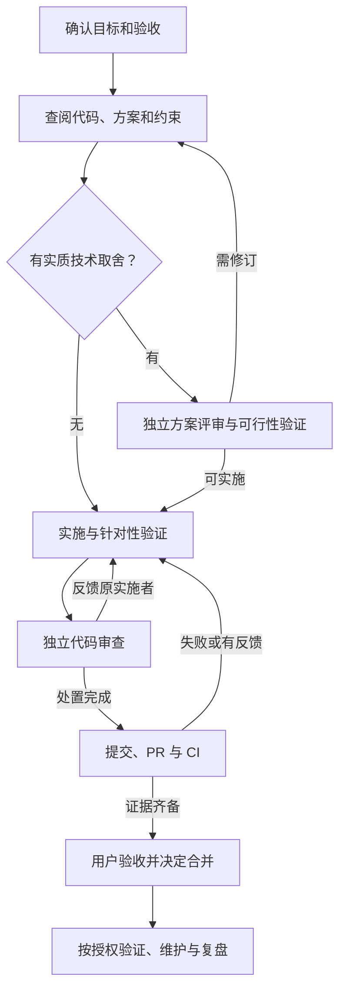

# 开发生命周期与任务接续

## 需求和现状调查

- 写清谁遇到什么问题、期望结果、范围、可观察的验收、风险和外部动作授权。验收尽量可复现，包含最重要的成功、失败和恢复场景。缺少关键事实或涉及用户必须决策的实质取舍时才提问。登记影响结果的合理假设。
- 开始时核对主机、仓库根目录、分支、HEAD、工作区改动、并行任务及相关 PR。沿项目权威入口查找实际调用方、已有代码、测试、部署与版本兼容。如果是在修复问题，尽可能先取得稳定复现或可核对的证据。
- 对运行行为、公开接口、权限、配置、持久状态等有影响的变更，记录四条实现边界：必需行为、已支持行为的兼容边界、不支持或本轮范围外的事项、可复用的替代路径。比较最少的可行选择和代价，包括沿用现有实现。新增依赖核对版本、官方接口、许可和维护状态。
- 小任务可用会话内短说明；跨文件、多阶段、涉及兼容或交接的任务用[任务记录](templates/task.md)。拆成可独立验证和回退的提交。因变更风险需要更细切分时，先明确各提交间如何保持可构建。

## 独立方案评审与技术决策

设计者写清问题、计划、重要候选和证据缺口。架构、持久性、权限、不可逆行为、外部依赖或实施成本有实质取舍时，在写运行代码前启动独立方案评审。

- 给新只读会话已固定版本的原始需求与候选方案、路径或摘要、仓库 Git 基线、范围、角色及可用测试权限。子代理路径先验证实际权限、收件回执及指定材料的读取。评审者独立读相关代码、测试和生效配置。以新会话或独立只读评审者从这些材料开始，省去设计聊天历史、设计者的推理草稿和导向性的发现。
- 评审者核对事实、可行性、替代方案、权限、兼容、失败与回退，给出可实施、需修改、需实测或阻断的结论及证据，按阻断性问题、必要修正、可选建议、待实测假设返回。可行性试验使用授权的隔离环境和最小样本；影响面或可行性有新结论时再次核对方案。
- 采用 [Codex CLI 关卡](adapters/codex-cli/README.md)的项目，通过一次进入实现的命令触发 reviewer。明确通过并复核计划与基线后，关卡才启动指定命令。项目在采用记录写明触发范围和已经验证的边界。创建成功、空任务、通用应答、缺少证据、输入不匹配或工具失败时停止。已验证的独立只读会话可人工发起并转交意见。
- 原设计者读到评审结果后逐项处置，验证成立的问题并更新计划并确认前一份评审对新版本是否有效，实质取舍交给用户决定。重要决策用[ADR](templates/adr.md)记录情境、候选、决定、后果和改判条件。后续决策引用被替代的记录，保留历史。
- [评审模板](templates/review.md)包含方案与代码两种入口。代码审查关注实现差异和已选方案的正确执行。

## 任务记录与冷恢复

同一目标延续主会话。跨阶段、交接或无法可靠恢复上下文时，更新同一份任务记录。记录目标、验收、授权、实际分支与基线、当前候选和改动、决定、已失败路线、已做验证及下一条可执行动作。轮次和上下文压缩次数可作为观察信息，是否切换由任务实际状态决定。

新会话先读根规则及任务记录，再安全地重读当前 Git 状态、相关代码和已有 PR/CI。已取得的授权以可核对的范围为准，冲突或缺失时明确具体决策。任务记录中的候选可落后于真实 HEAD，应核实差异后选择正确下一步。恢复验收要看到新会话找到权威入口、识别当时状态和阻断，并执行一条已授权的安全动作。[接续技能](skills/engineering-handoff/SKILL.md)封装了这项重复工作。

任务完成时给出实际结果、验证、交付位置和仍需人工决定的事项。任务尚未完成且有真实阻断时，保存阻断、已排除路径和可接续动作。阶段性结果随任务推进更新。
