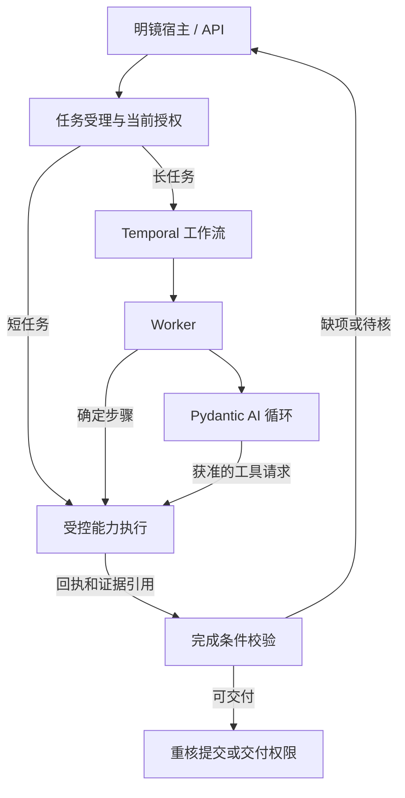

# 架构与契约

## 运行路径与信任边界

宿主后端把已认证身份和请求交给明镜应用。受理端分配 Task、Run 和稳定业务操作标识，将必要状态写入 PostgreSQL。普通程序可以直接调用。长任务交给 Temporal；Worker 在执行点根据任务固定的版本、当前发布与授权状态选择适配器。需要模型决定下一步时使用 Pydantic AI。确定性工作流和 Agent 访问相同的能力目录和执行约束。

该图说明将来各入口的责任。首个代码增量只落完成条件校验。PostgreSQL 将承载产品任务、授权、正式收据、预算与审计，Temporal History 仅承担引擎恢复。业务事实由有权业务系统提供，资料检索保留来源、版本、撤回状态。会话记录、当前推理上下文和可恢复任务状态分开保存。受限原文、供应商凭据与大文件通过按权限解析的引用访问。

## 共用边界

| 对象 / 边界 | 开发约定与失败处理 |
| --- | --- |
| 能力版本与调用 | 契约描述能力和版本、输入输出、错误、执行形态、资源、所需动作、副作用、重试与结果核实方式。登记、验证、按环境发布、按主体授权各自记录。发现仅列当前主体可见的候选，执行仍核权。 |
| Task、Run 与操作 | Task 表达目标，Run 表达一次运行。外部操作键跨重试稳定，尝试号按次生成，状态查阅按租户和资源授权。重复键若对应不同规范化输入应返回冲突。 |
| 受限处理 | 可信身份来自宿主或服务凭据。读取、发往模型、发往工具、正式写入和结果交付分别核对当前许可。恢复时重新解析受控引用、版本和权限。验证不可用则停止该动作，记录原因。 |
| 外部副作用 | 持久记录派发意图后发送。有可信查单接口则先查单，无法确定时保留未知与预留。父任务取消后停止新派发；迟到结果只用于核查已发生动作和结算。 |
| 业务完成与交付 | 任务固定完成条件、规则版本和证据来源。由可信适配器核验事实，形成逐项结论。缺项、冲突、使用错误版本或验证器不可用时保留理由。校验合格后，正式提交和受限交付仍各自通过权限边界。 |
| 预算与观测 | 新模型请求、工具和子任务在同一父级预算上预留，按可信用量幂等核销。无法确认的在途消耗继续占用。审计记录主体、资源、动作、操作号、版本与结果，日志使用摘要或受控引用。 |
| 模型和恢复 | 工具请求与返回配对，并设步数、时间与预算上限。模型替换须检查工具、结构化输出及上下文能力。需要精确恢复某次模型轮次时，先测中断位置、重放边界和敏感载荷，再定持久化适配方式。 |

## 采用与引入顺序

对照实验固定 Python 3.12.16、PostgreSQL 17.12、Temporal Server 1.32.2、SDK 1.36.1、Pydantic AI Slim 2.71.0。它们是该结果的复现版本。第一增量使用 Python 标准库。后续有实际调用路径时，再为所需运行依赖提交来源、许可、镜像摘要、分架构 wheel 哈希和安装验证。实验 B 的 32 项 lock 仅验证 Linux AMD64；仓库 P1/P2 的 ARM64 锁服务于旧代码。

生产模型、外部执行资源、部署拓扑、SLO 和配额仍需正式环境依据。实验中的本地 1.5B 模型在两条路线都使用了错误查询键。产品需按可信证据确认结果。PostHog 云端的既有选择如涉及新链路，接通、AI 观测与评测效果分别验收。

[实验固定版本及结果](https://github.com/zhuquanwei111/mingjing---agent/blob/553114d2114cc77081c415ad1697e74be282c9a8/lab/architecture/DECISION.md) · [开发顺序与验收](delivery.md)
